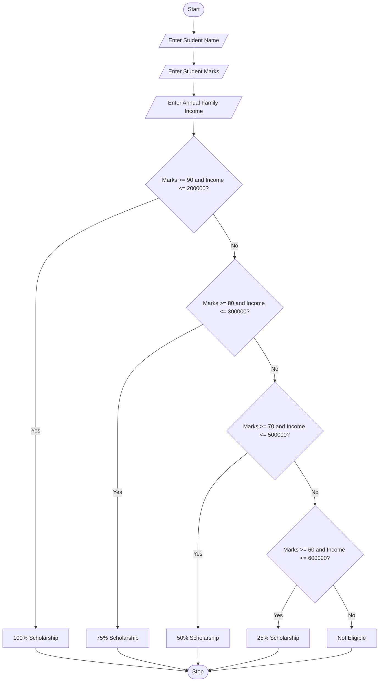

## Problem Statement
To develop a Python program for a University Scholarship Allocation System. The program accepts the student's name, marks percentage, and annual family income. Based on the marks and income, it checks the student's eligibility and allocates a scholarship of 100%, 75%, 50%, or 25%. If the student does not meet any condition, the program displays that the student is not eligible for a scholarship.

## Algorithm
1. Start the program.
   
2. Enter the student's name.
  
3. Enter the student's marks percentage.
5. Enter the annual family income.
6. Check whether marks are greater than or equal to 90 and income is less than or equal to ₹2,00,000.
7. If true, allocate a 100% scholarship.
8. Otherwise, check whether marks are greater than or equal to 80 and income is less than or equal to ₹3,00,000. If true, allocate a 75% scholarship.
9. Otherwise, check whether marks are greater than or equal to 70 and income is less than or equal to ₹5,00,000. If true, allocate a 50% scholarship.
10. Otherwise, check whether marks are greater than or equal to 60 and income is less than or equal to ₹6,00,000. If true, allocate a 25% scholarship.
11. If none of the conditions are satisfied, display that the student is not eligible.
12. Stop the program.

## Python source code
```
name = input("Enter student name: ")
marks = float(input("Enter student marks (%): "))
income = float(input("Enter annual family income: "))

if marks >= 90 and income <= 200000:
    print("Congratulations!", name)
    print("You are eligible for a 100% scholarship.")

elif marks >= 80 and income <= 300000:
    print("Congratulations!", name)
    print("You are eligible for a 75% scholarship.")

elif marks >= 70 and income <= 500000:
    print("Congratulations!", name)
    print("You are eligible for a 50% scholarship.")

elif marks >= 60 and income <= 600000:
    print("Congratulations!", name)
    print("You are eligible for a 25% scholarship.")

else:
    print("Sorry!", name)
    print("You are not eligible for a scholarship.")
```

## Sample Input

Enter student name: Ravi
Enter student marks (%): 92
Enter annual family income: 150000

## Sample Output

Congratulations! Ravi
You are eligible for a 100% scholarship.

## Flowchart




