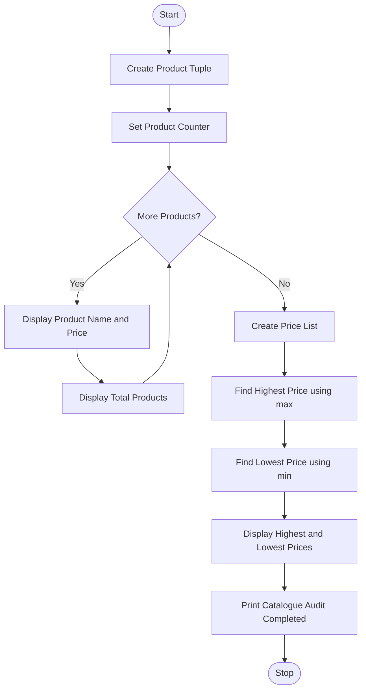

# Problem Statement
To write a Python program using tuples to store product names and their prices. The program displays all products, counts the total number of products, identifies the highest and lowest prices, and completes a catalogue audit.

# Algorithm
1. Start the program.
2. Create a tuple containing product names and prices.
3. Use a for loop to access each product.
4. Display the product name and price.
5. Calculate and display the total number of products using len().
6. Create a list of product prices.
7. Find the highest price using max().
8. Find the lowest price using min().
9. Display the highest and lowest prices.
10. Display "Catalogue Audit Completed".
11. Stop the program.

# Python source code
```
products = (
    ("Pen", 10),
    ("Book", 50),
    ("Bag", 500),
    ("Pencil", 5)
)

for product in products:
    print("Product:", product[0])
    print("Price: Rs.", product[1])
    print("Total Products:", len(products))

prices = [product[1] for product in products]

print("Highest Price:", max(prices))
print("Lowest Price:", min(prices))

print("Catalogue Audit Completed")
```
# Sample input
Product details are predefined in the tuple.

# Sample output
Product: Pen
Price: Rs. 10
Total Products: 4
Product: Book
Price: Rs. 50
Total Products: 4
Product: Bag
Price: Rs. 500
Total Products: 4
Product: Pencil
Price: Rs. 5
Total Products: 4
Highest Price: 500
Lowest Price: 5
Catalogue Audit Completed

# Flowchart



