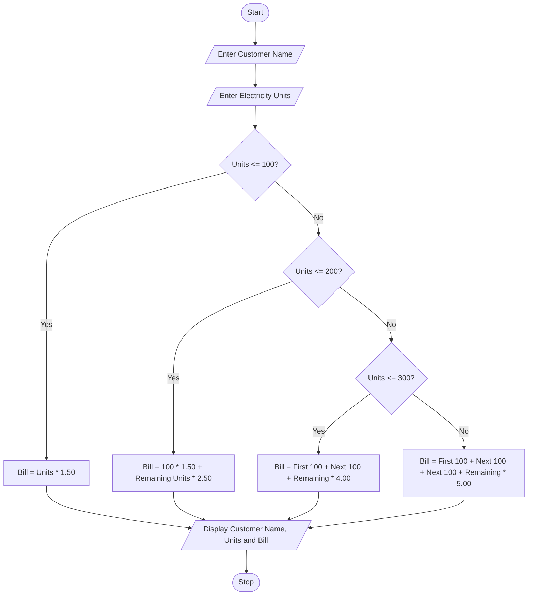

## Problem Statement
To write a Python program to calculate the electricity bill based on the number of units consumed by a customer using progressive billing rates. The program accepts the customer name and electricity units, calculates the total bill, and displays the customer details and bill amount.

## Algorithm
1. Start the program.
2. Read the customer name.
3. Read the electricity units consumed.
4. If units are less than or equal to 100, calculate the bill at ₹1.50 per unit.
5. If units are between 101 and 200, calculate the first 100 units at ₹1.50 and remaining units at ₹2.50.
6. If units are between 201 and 300, calculate the first 100 units at ₹1.50, next 100 units at ₹2.50, and remaining units at ₹4.00.
7. If units are above 300, calculate the first 100 units at ₹1.50, next 100 units at ₹2.50, next 100 units at ₹4.00, and remaining units at ₹5.00.
8. Display the customer name, units consumed, and total electricity bill.
9. Stop the program.

 ## Python source code
 ```
name = input("Enter customer name: ")
units = int(input("Enter electricity units consumed: "))

if units <= 100:
    bill = units * 1.50

elif units <= 200:
    bill = (100 * 1.50) + ((units - 100) * 2.50)

elif units <= 300:
    bill = (100 * 1.50) + (100 * 2.50) + ((units - 200) * 4.00)

else:
    bill = (100 * 1.50) + (100 * 2.50) + (100 * 4.00) + ((units - 300) * 5.00)

print("Customer Name:", name)
print("Units Consumed:", units)
print("Total Electricity Bill: Rs.", bill)
```
## Sample input
Enter customer name: Ravi
Enter electricity units consumed: 250

## Sample output
Customer Name: Ravi
Units Consumed: 250
Total Electricity Bill: Rs. 600.0

## Flow chart




