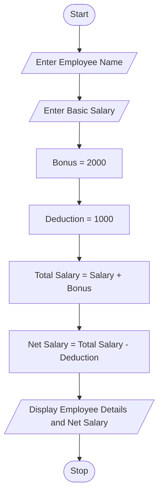

## Problem statement

To write a Python program to calculate an employee's net salary based on the basic salary, fixed bonus, and deduction. The program accepts the employee name and basic salary, calculates the total salary and net salary, and displays the salary details.

## Algorithm
1. Start the program.
2. Enter the employee name.
3. Enter the basic salary.
4. Assign bonus as ₹2000.
5. Assign deduction as ₹1000.
6. Calculate total salary by adding basic salary and bonus.
7. Calculate net salary by subtracting deduction from total salary.
8. Display employee name, basic salary, bonus, deduction, and net salary.
9. Stop the program.

 ## Python source code
 ```
name = input("Enter Employee Name: ")
salary = float(input("Enter Basic Salary: "))

bonus = 2000
deduction = 1000

total_salary = salary + bonus
net_salary = total_salary - deduction

print("Employee Name:", name)
print("Basic Salary:", salary)
print("Bonus:", bonus)
print("Deduction:", deduction)
print("Net Salary:", net_salary)
```
## Sample input

Enter Employee Name: Ravi
Enter Basic Salary: 25000

## Sample output

Employee Name: Ravi
Basic Salary: 25000.0
Bonus: 2000
Deduction: 1000
Net Salary: 26000.0

## Flow chart



