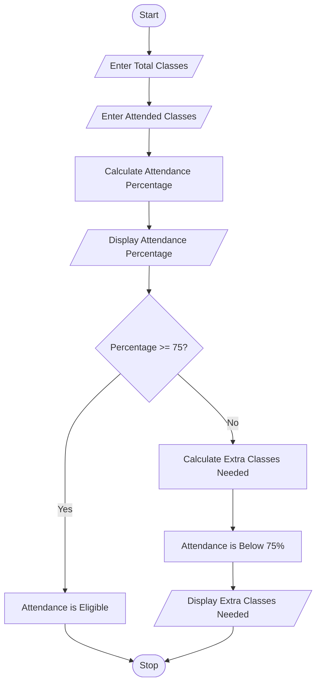

# Problem Statement
To write a Python program to calculate a student's attendance percentage and check whether the student is eligible for examinations based on the minimum attendance requirement of 75%. If the attendance is below 75%, the program calculates the extra classes required to reach the eligibility percentage.

# Algorithm
1. Start the program.
2. Enter the total number of classes.
3. Enter the number of classes attended.
4. Calculate attendance percentage using the formula:
   
   Attendance Percentage = (Attended Classes / Total Classes) × 100
5. Display the attendance percentage.
6. Check whether the attendance percentage is greater than or equal to 75%.
7. If the condition is true, display "Attendance is Eligible".
8. Otherwise, calculate the extra classes needed.
9. Display "Attendance is Below 75%".
10. Display the extra classes needed.
11. Stop the program.

# Python source code
```
total = int(input("Enter total classes: "))
attended = int(input("Enter attended classes: "))

percentage = (attended / total) * 100

print("Attendance Percentage:", percentage)

if percentage >= 75:
    print("Attendance is Eligible")

else:
    needed = (0.75 * total - attended) / 0.25
    print("Attendance is Below 75%")
    print("Extra Classes Needed:", int(needed) + 1)
```
# Sample input 
Enter total classes: 100
Enter attended classes: 60

# Sample output
Attendance Percentage: 60.0
Attendance is Below 75%
Extra Classes Needed: 60

# Flow chart



