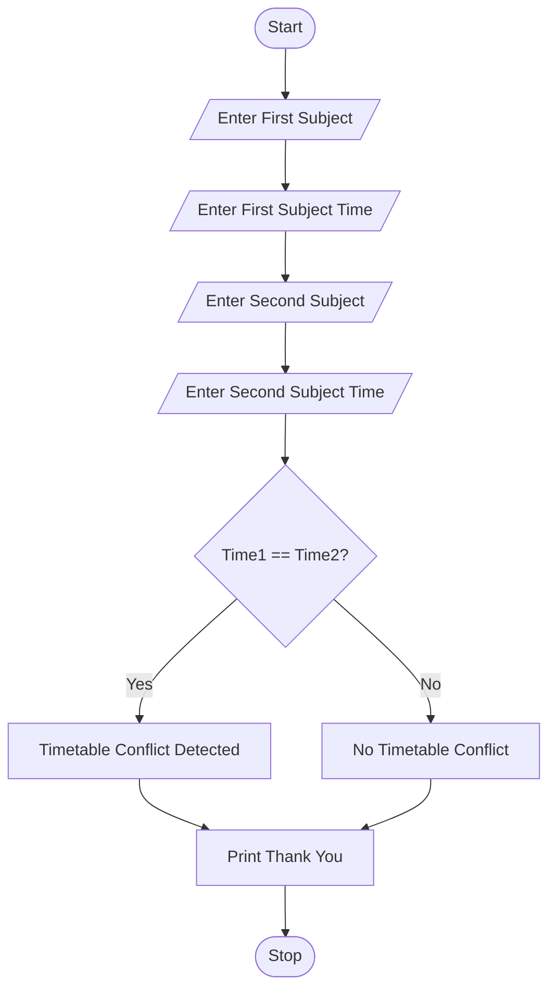

# Problem Statement
To write a Python program to detect timetable conflicts between two subjects by comparing their scheduled times. If both subjects have the same time, the program displays a conflict message; otherwise, it displays no conflict.

# Algorithm
1. Start the program.
2. Enter the first subject name.
3. Enter the first subject time.
4. Enter the second subject name.
5. Enter the second subject time.
6. Compare both subject times.
7. If both times are equal, display "Timetable Conflict Detected!".
8. Otherwise, display "No Timetable Conflict".
9. Display "Thank You".
10. Stop the program.

# Python source code
```
sub1 = input("Enter first subject: ")
time1 = input("Enter first subject time: ")

sub2 = input("Enter second subject: ")
time2 = input("Enter second subject time: ")

if time1 == time2:
    print("Timetable Conflict Detected!")
else:
    print("No Timetable Conflict")

print("Thank You")
```
# Sample input
Enter first subject: Python
Enter first subject time: 10AM
Enter second subject: Java
Enter second subject time: 10AM

# Sample output
Timetable Conflict Detected!
Thank You

# Flow chart



