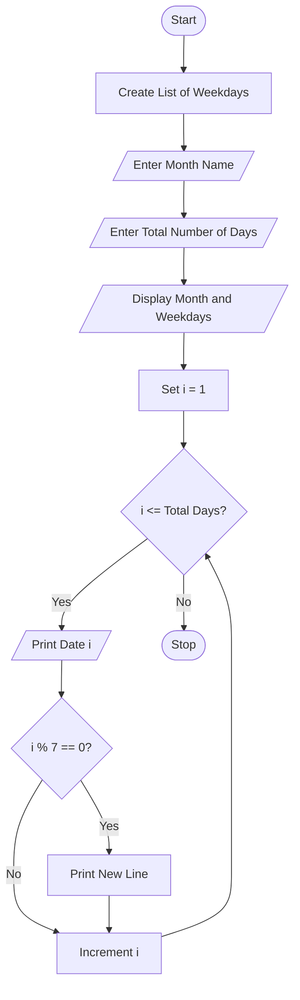

# Problem Statement
To write a Python program to generate a simple monthly calendar. The program accepts the month name and total number of days, displays the weekdays, and prints the dates in rows of seven days.
 # Algorithm
1. Start the program.
2. Create a list containing the seven weekdays.
3. Enter the month name.
4. Enter the total number of days in the month.
5. Display the month name.
6. Display all seven weekdays.
7. Use a loop to print dates from 1 to the total number of days.
8. Print a new line after every seven dates.
9. Stop the program.

# Python source code
```
days = ["Mon", "Tue", "Wed", "Thu", "Fri", "Sat", "Sun"]

month = input("Enter month name: ")
total_days = int(input("Enter number of days: "))

print("   ", month)

for day in days:
    print(day, end=" ")

print()

for i in range(1, total_days + 1):
    print(i, end=" ")
    if i % 7 == 0:
        print()

print()
```
# Sample input
Enter month name: January
Enter number of days: 31

# Sample output
    January
Mon Tue Wed Thu Fri Sat Sun
1 2 3 4 5 6 7
8 9 10 11 12 13 14
15 16 17 18 19 20 21
22 23 24 25 26 27 28
29 30 31

# Flow chart



