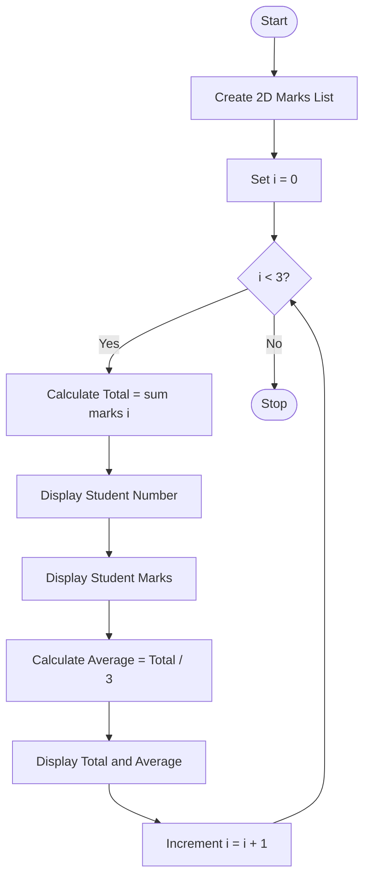

# Problem Statement
To write a Python program using a two-dimensional list (matrix) to store the marks of three students in three subjects. The program calculates and displays each student's total marks and average marks.

# Algorithm
1. Start the program.
2. Create a 2D list containing marks of three students in three subjects.
3. Use a for loop to access each student's marks.
4. Calculate the total marks using the sum() function.
5. Display the student number.
6. Display the marks of each student.
7. Calculate the average by dividing total marks by 3.
8. Display the total and average marks.
9. Repeat the process for all students.
10. Stop the program.

 # Python source code
 ```
marks = [
    [80, 70, 90],
    [60, 75, 85],
    [90, 95, 80]
]

for i in range(3):
    total = sum(marks[i])
    print("Student", i+1)
    print("Marks:", marks[i])
    print("Total:", total)
    print("Average:", total/3)
    print()
```
# Sample input
Marks of students:

Student 1: 80, 70, 90
Student 2: 60, 75, 85
Student 3: 90, 95, 80

# Sample output
Student 1
Marks: [80, 70, 90]
Total: 240
Average: 80.0

Student 2
Marks: [60, 75, 85]
Total: 220
Average: 73.33333333333333

Student 3
Marks: [90, 95, 80]
Total: 265
Average: 88.33333333333333

# Flow chart


```


